# Отчёт по лабораторной работе №2 (Node-RED)

**ФИО:** Обуховский Кирилл
**Группа:** УИР-241

## Способ установки
Node-RED установлен через npm (без Docker).
- Node.js: v26.13.0
- Node-RED: v5.0.9

## Освоенные ноды
В ходе работы я освоил следующие ноды: inject, debug, function, switch, change, template, http request, mqtt in/out, http in/response, ui_gauge, ui_chart, telegram receiver/sender/command, file in/out, flow context.

## Использованные AI-промпты
1. «Сгенерируй JS-код для function node с if/else, циклом for, массивом и объектом»
2. «Составь Mustache-шаблон для JSON с полями name, lab, group»
3. «Настрой MQTT flow с публичным брокером broker.hivemq.com»
4. «Как в Node-RED настроить отправку сообщений в Telegram через бота»

## Результаты работы (скриншоты)

**Версии Node.js и Node-RED:**
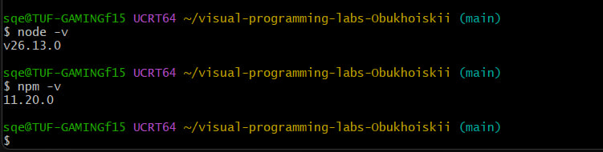
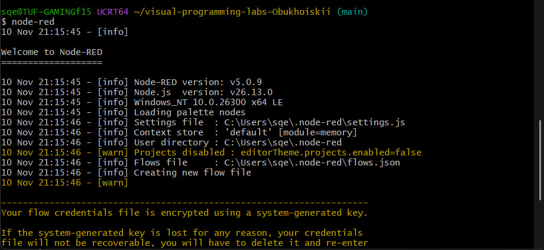

**Потоки 2.1 - 2.5:**
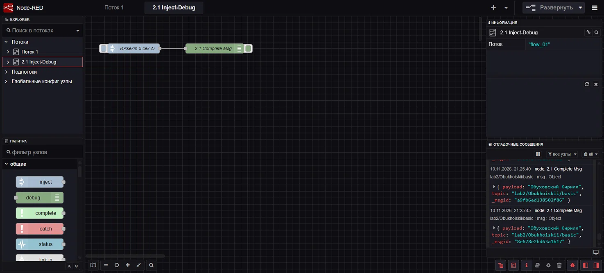
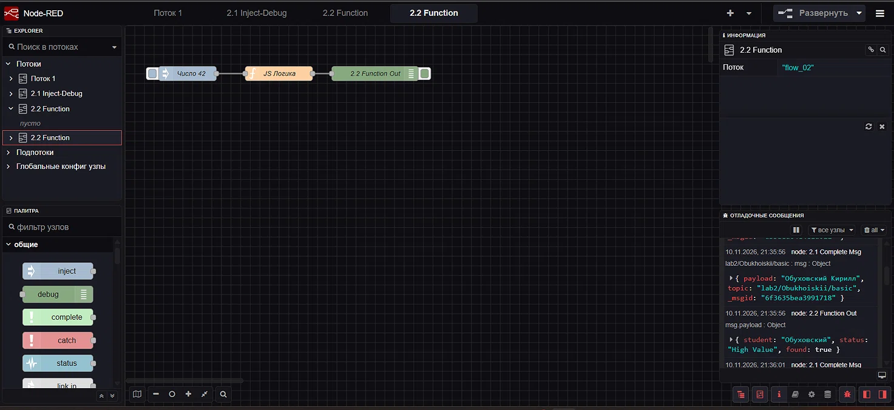
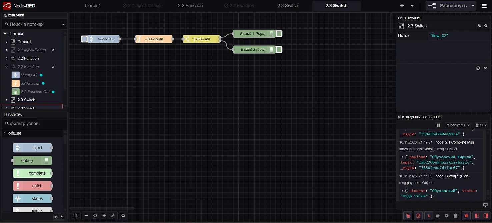
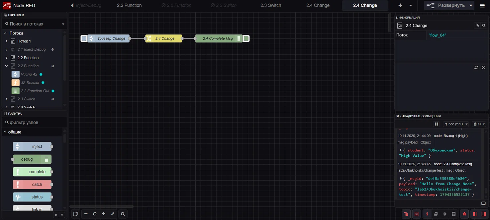
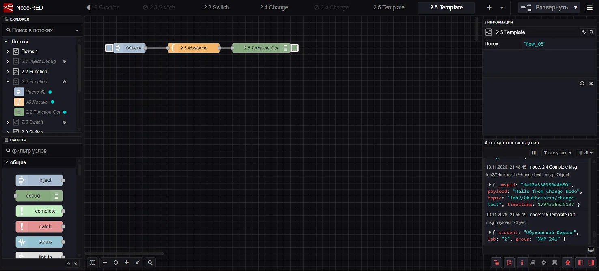

**Потоки 2.6 - 2.10:**
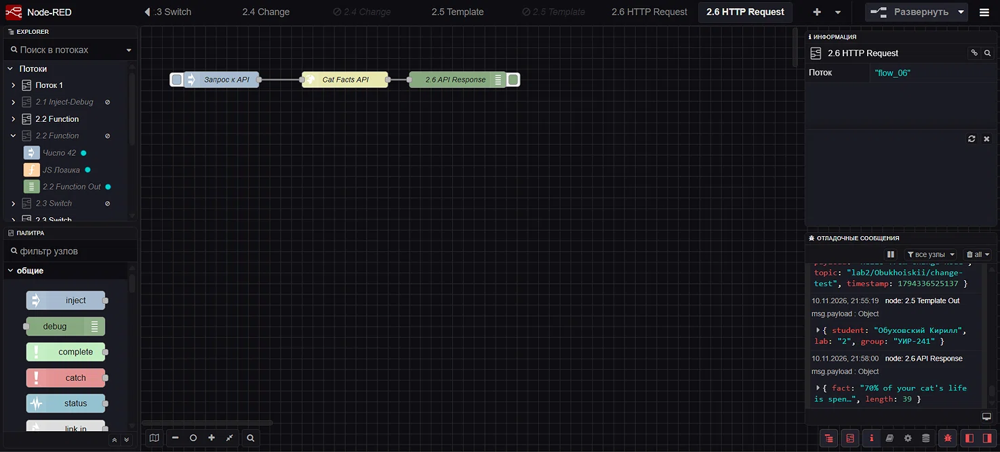
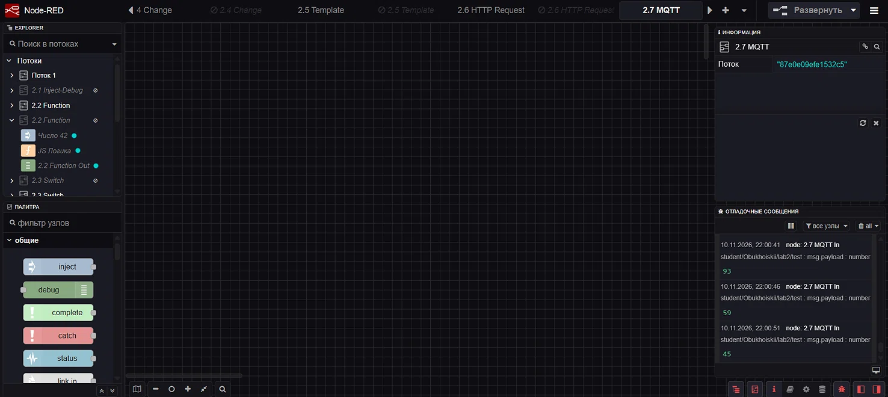

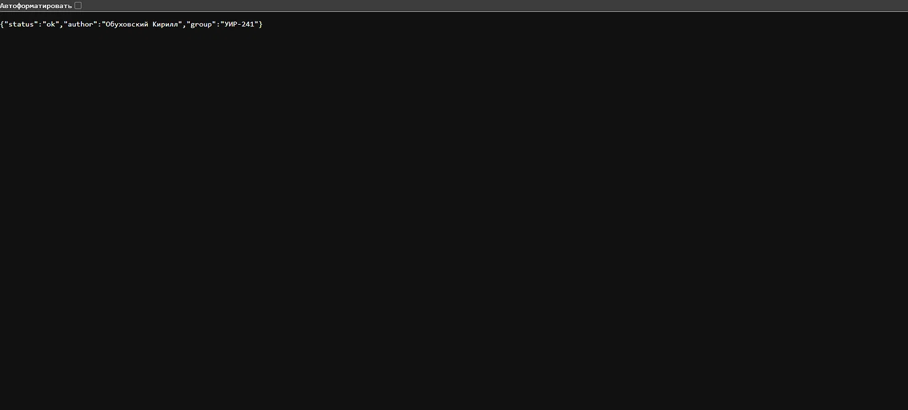

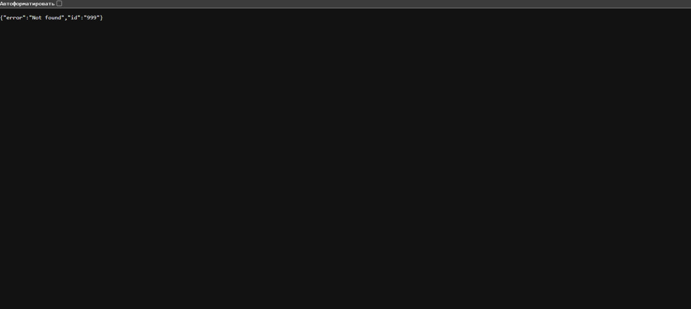
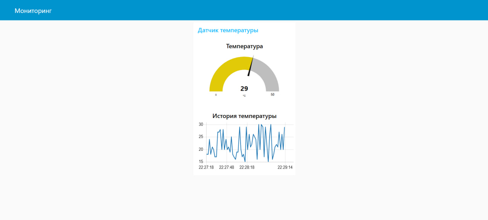
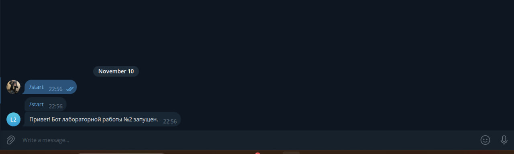

**Потоки 2.11 - 2.12:**
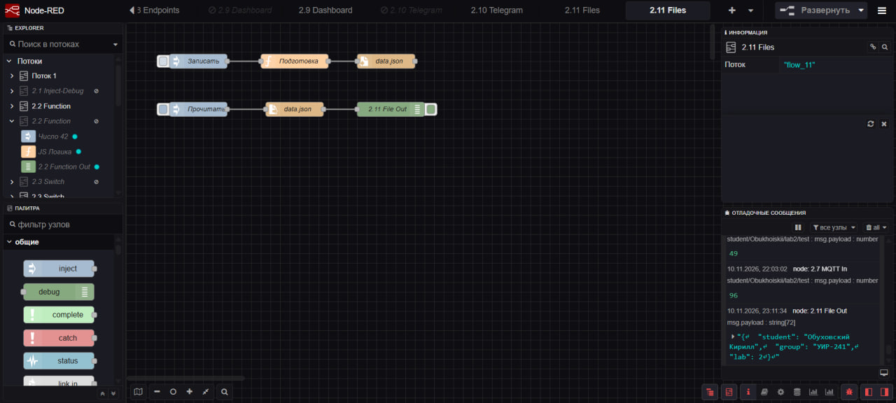
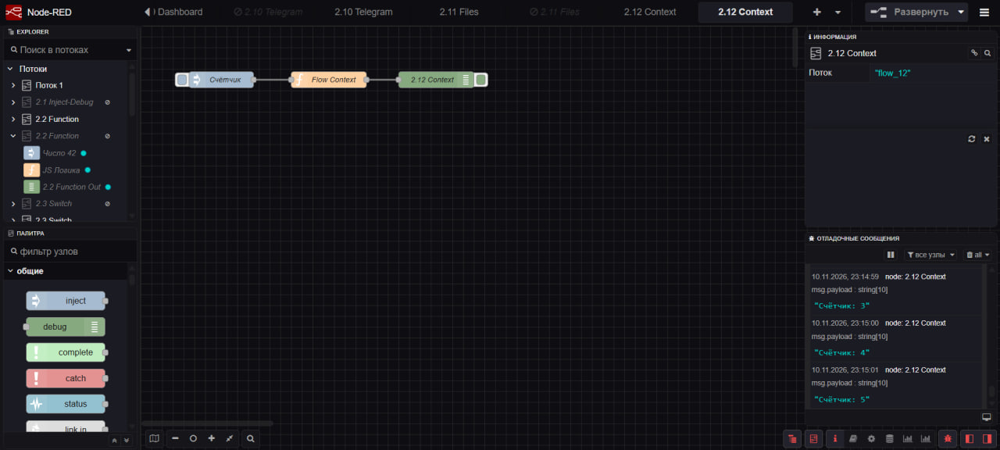

## Выводы
В ходе работы я освоил Node-RED как мощный low-code инструмент для визуального программирования. Я научился собирать потоки из готовых нод, писать логику на JavaScript в function-нодах, настраивать HTTP-эндпоинты и делать запросы к внешним API, работать с протоколом MQTT, Telegram-ботами и интерактивными дашбордами. Также я понял, как использовать контекст (flow context) для сохранения состояния и как работать с файловой системой на Windows.
